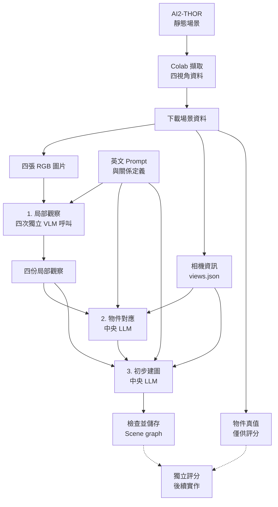

# ai2thor_benchmark

讀取 AI2-THOR 匯出的四視角資料，透過本機 Ollama 的 `gemma4:e4b` 完成局部觀察、物件對應與 scene graph。**根目錄建圖流程不需執行 AI2-THOR**；目前完成研究階段 1–3，模型輸入與回答使用英文。

## 文件索引

| 文件 | 內容 |
| --- | --- |
| [專案架構](docs/architecture.md) | 目錄、各 Python 檔案功能與依流程的互動方式。 |
| [Ollama 指南](docs/ollama_guide.md) | 合併原 instruction／interaction：呼叫與隔離、參數、重試、續跑、紀錄位置及實測案例。 |
| [輸出格式](docs/output_format.md) | 各階段的固定欄位、ID、引用與正規化規則。 |
| [研究設計與 prompts](docs/research_design.md) | 階段 0–6 的設計、完整中英文 prompts 與評估規劃。 |
| [本機任務示範](local/README.md) | 獨立的 AI2-THOR 動作計畫、環境設定與測試。 |
| [歷史範例](local/examples/legacy/README.md) | 舊動作草稿、影片、紀錄與環境清單的用途。 |

## 快速開始

1. 在可執行 AI2-THOR 的環境使用 [Colab Notebook](colab/AI2_THOR_Scene_Capture.ipynb) 擷取 **四個**視角，將 ZIP 解壓縮至 `colab/scene_output/<場景資料夾>/`。操作說明在 Notebook 內。
2. 建圖電腦需有 Python 3.10+ 與 Ollama；Python 部分只用標準函式庫。啟動服務並準備模型：

```sh
ollama serve
# 在另一個終端執行；模型已安裝可略過：
ollama pull gemma4:e4b
```

3. 在專案根目錄執行，將範例路徑替換成自己的場景目錄：

```sh
python run_scene_graph.py --scene-dir colab/scene_output/20261021T030626_636386Z
# 只檢查資料並輸出 prompt，不連線 Ollama：
python run_scene_graph.py --scene-dir colab/scene_output/20261021T030626_636386Z --dry-run
# 離線測試，不需模型或模擬器：
python -S -m unittest discover -s tests -v
```

四個 view 使用相同英文模板，各自獨立、依序呼叫；中央模型另用純文字對話。完整新 run 若一次全通過共六次推論，每任務預設最多再修正三次。參數、失敗處理與恢復指令見 [Ollama 指南](docs/ollama_guide.md)。

## 資料與建圖流程



圖中節點只列步驟名稱；輸入與輸出如下。建圖輸出路徑皆相對於 `outputs/<run_id>/`。

| 階段 | 預期輸入 | 預期輸出 |
| --- | --- | --- |
| 0. 資料擷取 | 場景、四個拍攝位置與相機設定。 | 場景目錄的 `view_01.png`～`view_04.png`、`views.json`；另存真值 `objects.json/.csv`。 |
| 1. 局部觀察 | 每次一張原圖、視角 ID、相同英文 prompt。 | `observations/view_1.md`～`view_4.md`：物件、關係、證據與不確定事項。 |
| 2. 物件對應 | 四份觀察、篩選後的相機資訊。 | `correspondence.md`：全域 ID、局部到全域對應、候選與歧義。 |
| 3. 初步建圖 | 觀察、對應、相機資訊、關係定義與查證預算。 | `scene_graph.md`：三元組（如 `(g1, on, g2)`）、來源、狀態與待查證問題。 |
| 檢查與紀錄 | 各任務回答、規則與呼叫資料。 | `prompts/`、`responses/`、`normalizations/`、`camera_metadata.json`、`validation_report.json`、`run_manifest.json`。 |

`run_id` 是 UTC 時間，例如 `20261021T161450_548982Z` 表示 2026-10-21 16:14:50.548982 UTC。每個新 run 使用獨立目錄，產物不納入 Git；每次輸入與回答的保存方式見 [紀錄位置](docs/ollama_guide.md#5-輸入與結果位置)。

`objects.json/.csv` 與真值物件總數不送入模型。相機位置採 `cameraPosition`，中央模型只接收白名單資訊。程式驗證格式與來源引用，無法保證場景辨識正確；階段 4–6 的回看查證、圖更新與下游任務尚未實作。完整設計見 [研究文件](docs/research_design.md)。

## 本機 AI2-THOR 任務示範

`local/` 是獨立的固定動作任務，不會自動讀取根目錄產生的 scene graph。請在可執行 AI2-THOR 的電腦操作；本機環境與離線測試指令見 [本機說明](local/README.md)。

```sh
cd local
python -m pip install -r requirements.txt
python main.py
```
