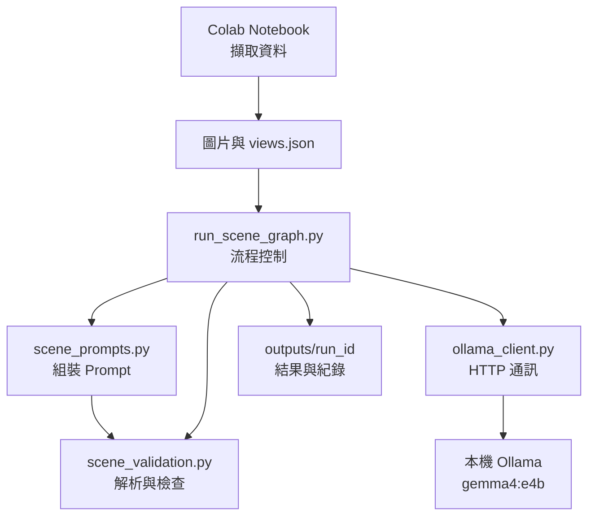
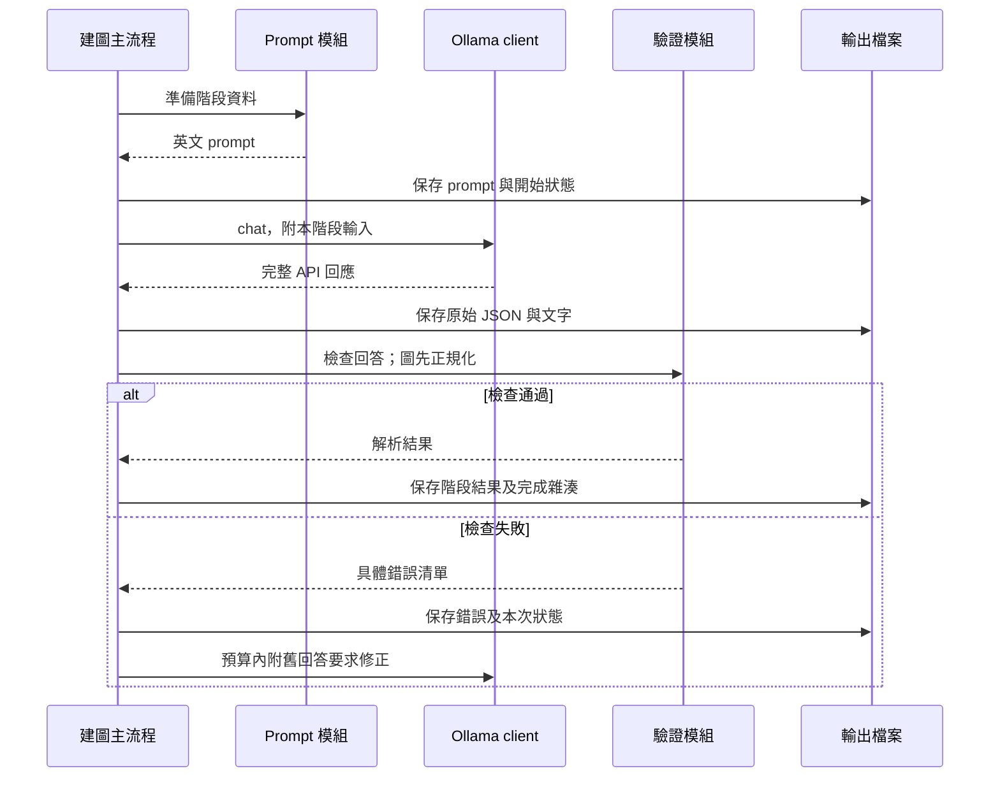

# 專案架構與檔案互動

本專案先取得 AI2-THOR 的四視角資料，再透過本機 Ollama，依序完成局部觀察、跨視角物件對應與初版 scene graph。建圖程式使用 Python 標準函式庫，讀取已匯出的資料即可執行。

快速開始見 [README](../README.md)，參數、對話隔離與修正案例見 [Ollama 指南](ollama_guide.md)，欄位規格見 [輸出格式](output_format.md)，完整 prompts 見 [研究設計](research_design.md)。以下描述目前實作；階段 4–6 為後續工作。

## 1. 目錄與功能

```text
ai2thor_benchmark/
├── run_scene_graph.py         建圖入口與流程控制
├── scene_prompts.py           英文 prompts 與關係定義
├── ollama_client.py           Ollama HTTP 通訊
├── scene_validation.py        文字解析、驗證與可追溯正規化
├── requirements.txt           說明建圖程式無第三方 Python 依賴
├── README.md                  快速開始、流程圖與文件索引
├── docs/
│   ├── architecture.md        本文件
│   ├── ollama_guide.md         操作參數、互動、修正與案例
│   ├── output_format.md       輸出欄位與正規化規則
│   └── research_design.md     研究設計與完整階段 prompts
├── tests/test_scene_graph.py  建圖流程的離線回歸測試
├── colab/
│   ├── AI2_THOR_Scene_Capture.ipynb  擷取場景資料
│   └── scene_output/          匯出的圖片、相機資料與物件真值
├── outputs/                   各次建圖結果與執行紀錄，Git 忽略
└── local/                     獨立的 AI2-THOR 任務示範與評估程式
```

| 模組 | 主要功能與介面 |
| --- | --- |
| [run_scene_graph.py](../run_scene_graph.py) | `main()` 解析參數；`load_scene()` 讀取並篩選資料；`run()` 建立或載入 run；`execute()` 執行階段；內部 `obtain()` 統一處理生成、快取、驗證、修正與保存。 |
| [scene_prompts.py](../scene_prompts.py) | 保存 `COMMON`、各階段模板與 `RELATIONS`；提供 `observation_prompt()`、`correspondence_prompt()`、`graph_prompt()`。 |
| [ollama_client.py](../ollama_client.py) | `OllamaClient.preflight()` 查詢服務、模型能力與 digest；`chat()` 組裝訊息、編碼圖片並呼叫模型；HTTP 錯誤轉為 `OllamaError`。 |
| [scene_validation.py](../scene_validation.py) | `validate_observation()`、`validate_correspondence()`、`validate_graph()` 檢查各階段；`normalize_graph()` 修正能唯一確定的 frame 別名並合併重複邊；錯誤以 `ValidationError` 回報。 |
| [tests/test_scene_graph.py](../tests/test_scene_graph.py) | 使用假的模型回答與 HTTP server，驗證資料隔離、引用、修正、續跑與 fork；不需要實際模型或模擬器。 |

## 2. 模組如何互相呼叫



圖中模組箭頭表示呼叫或依賴。三階段都由 `run_scene_graph.py` 協調；prompt 模組回傳文字，client 回傳模型回應，validator 回傳解析結果或錯誤。檔案寫入集中由主流程處理。

`scene_prompts.graph_prompt()` 也會呼叫驗證器，從已通過檢查的模型輸出產生「節點清單」與「局部關係端點對照」，附入建圖 prompt。這些輔助表用來維持 ID 與來源一致，內容全部來自模型觀察及對應結果。

## 3. 依運作順序追蹤資料

### 步驟 0：擷取 AI2-THOR 場景

[Colab Notebook](../colab/AI2_THOR_Scene_Capture.ipynb) 啟動 AI2-THOR，透過 `GetReachablePositions` 選點，再用 `Teleport` 調整拍攝位置與朝向。匯出 ZIP 後，將資料解壓縮至 `colab/scene_output/<資料夾>/`。

| 檔案 | 後續用途 |
| --- | --- |
| `view_01.png`～`view_04.png` | 階段 1 的四張 RGB 圖片。 |
| `views.json` | 圖片清單、相機位置、朝向、俯仰角、FOV 與單位。 |
| `objects.json/.csv` | 模擬器物件真值，留待獨立評分；建圖流程不讀取。 |
| `reachable_positions.json`、`viewpoints.png` | 拍攝位置的輔助資料，根目錄建圖流程不使用。 |

Notebook 可擷取三或四個位置；目前根目錄建圖程式要求恰好四張圖片，名稱為 `view_01.png`～`view_04.png`。

### 步驟 1：啟動並準備執行

1. `main()` 解析資料路徑、模型、階段與生成參數，交給 `run()`。
2. `load_scene()` 依 `views.json` 清單讀取四張圖片，檢查路徑、PNG 標頭、座標數值與單位，並計算輸入雜湊。
3. 主流程僅保留 `cameraPosition`、agent yaw、`cameraHorizon`、FOV、座標說明與單位，寫入 `camera_metadata.json`。原本 `views.json` 的 `object_count` 不進入 prompt。
4. `run()` 建立獨立輸出目錄、設定與程式雜湊，使用 `.run.lock` 防止同一目錄被多個程序同時寫入。
5. `execute()` 建立 `OllamaClient`，呼叫 `preflight()` 查詢 `/api/version`、`/api/show`、`/api/tags`，確認影像能力並記錄模型版本資訊。

### 階段 1：四次獨立局部觀察

對 `view_1`～`view_4` 依序執行：

1. 主流程呼叫 `observation_prompt(index)`，套用相同英文模板，只替換視角 ID。
2. `obtain()` 將共通規則、prompt 與該張圖片交給 `OllamaClient.chat()`。
3. client 將圖片 bytes 編成 base64，放入使用者訊息的 `images` 欄位，向 `/api/chat` 傳送請求。
4. 回答交給 `validate_observation()`，檢查局部物件 ID、關係兩端、參考類型與不確定性欄位。
5. 通過後保存為 `observations/view_N.md`，並將文字留在記憶體，供下一階段使用。

四次呼叫使用同一個模型，但各自建立獨立對話，只接收自己的圖片與視角資訊。相機姿態與其他視角回答不會送入這一階段。

### 階段 2：中央模型做物件對應

1. 主流程將四份觀察文字與篩選後的相機資訊交給 `correspondence_prompt()`。
2. client 發出一次純文字呼叫，模型建立全域 ID、局部到全域對應與未確定候選。
3. `validate_correspondence()` 重新解析四份觀察，檢查每個局部物件都有去向、全域來源與對應表一致，且同一視角的不同物件沒有被確定合併。
4. 通過後保存為 `correspondence.md`，文字結果傳給階段 3。

### 階段 3：中央模型建立初版圖

1. `graph_prompt()` 組合四份觀察、物件對應、相機資訊、關係定義與查證問題上限，並附上可複製的節點清單及來源對照。
2. client 發出一次純文字呼叫，模型產生節點、`(g1, on, g2)` 等三元組、證據、未解問題與查證請求。
3. `normalize_graph()` 處理可由來源唯一確定的 frame 別名，以及相同三元組、相同參考系的重複邊，記錄變更與保留的來源、ID、狀態。
4. `validate_graph()` 嚴格檢查節點、關係名稱、參考系、對應端點、來源、不確定狀態及查證預算。
5. 通過後保存 `scene_graph.md`，將 manifest 狀態設為 `complete`。

目前支援 `on`、`inside`、`image_left_of`、`closer_to_camera`；前兩者的 frame 為 `physical`，後兩者必須指定來源 `view_N`。查證請求只保存，不會觸發階段 4 的 VLM 呼叫。

首次執行的階段間資料主要以記憶體中的文字傳遞；Markdown 是保存、查閱與續跑的依據。模型不會自行開啟專案檔案。

## 4. 每次模型呼叫的共同處理



主流程會先檢查是否已有雜湊一致且可通過驗證的完成檔案，有則直接重用。新增生成時，原始回答先保存，再進行檢查；僅階段 3 使用圖正規化。

格式或引用錯誤預設最多修正三次。修正呼叫帶入原始任務、上一份回答及錯誤清單；階段 1 仍附自己的原圖。若相同錯誤回答重複出現則提前停止。HTTP 失敗、回答空白或截斷會保存診斷並停止，不會直接當成有效結果。

## 5. 輸出檔案如何配合

輸出位於 `outputs/<run_id>/`。`run_id` 使用 UTC 時間，例如 `20261021T161450_548982Z`。

| 檔案／目錄 | 產生者與使用方式 |
| --- | --- |
| `camera_metadata.json` | 主流程寫入的相機白名單資料，方便核對送入中央模型的資訊。 |
| `observations/view_1.md`～`view_4.md` | 階段 1 通過檢查的回答，供階段 2–3 使用。 |
| `correspondence.md` | 階段 2 的對應結果，提供階段 3 與圖驗證器使用。 |
| `scene_graph.md` | 階段 3 通過檢查的圖；有正規化時保存其結果。 |
| `prompts/` | 主流程保存每個任務、每次嘗試實際使用的文字。 |
| `responses/*.json`、`*.md` | 完整 API 回應與原始回答；含失敗嘗試，供診斷及 fork 恢復使用。 |
| `responses/*.normalized.md`、`normalizations/*.json` | 發生正規化時保存修正草稿、前後雜湊、frame 修正及重複邊合併紀錄。 |
| `validation_report.json` | 各任務的檢查結果、錯誤與物件／邊數量；不代表場景辨識正確率。 |
| `run_manifest.json` | 輸入及程式雜湊、模型設定與 digest、完成檔案雜湊、嘗試紀錄、耗時與 token 用量；續跑與 fork 都會讀取。 |

## 6. 續跑與程式修正後的恢復

| 模式 | 檔案互動 |
| --- | --- |
| `--resume RUN` | 在同一目錄繼續。核對輸入、程式、生成設定與模型 digest；逐一重驗完成檔案，僅生成未完成任務。 |
| `--fork-from RUN` | `reusable_run()` 讀取舊 manifest，核對輸入、設定與檔案雜湊，以目前驗證器重驗階段 1–2，複製到新 run，記錄來源，保留舊 run。 |
| `--dry-run` | 只檢查輸入並輸出相機資料、局部 prompt 與中央階段模板，不連線 Ollama。此目錄不能拿來續跑推論。 |

fork 也會嘗試匯入舊 run 最近一份完整傳回的建圖回答，即使它曾驗證失敗。新程式先正規化並重驗；通過可直接恢復，否則只請中央模型修正該回答。只要執行推論流程，即使重用全部結果，也仍會做 Ollama 服務與模型的 preflight。

新建圖通常是四次局部觀察、一次對應、一次建圖，共六次呼叫；修正會增加次數，重用或恢復則可減少新呼叫。

## 7. 獨立的 local 模擬器流程

`local/` 是原有固定任務示範，不由根目錄建圖程式匯入，也不會自動讀取 `scene_graph.md`。要執行需具備 AI2-THOR 環境。

```text
local/main.py
  ├─ demo_task.py → task_definition.py → pddl_goal.py
  └─ simulation_platform.py
       ├─ robot_interface.py → AI2-THOR Controller
       ├─ benchmark_referee.py → pddl_goal.py
       └─ Logger／影格回呼 → trace_log.json／run.mp4
```

`main.py` 建立 controller、由 `demo_task.py` 取得任務與動作計畫，交給 `SimulationPlatform`。每一步由 `RobotInterface` 轉成模擬器動作，再由 `Referee` 根據 metadata 與 PDDL 目標判定成功，最後記錄 JSON 並選用錄影。結束時釋放資源。詳見 [local/README.md](../local/README.md)。

## 8. 資料邊界與目前範圍

- 階段 1 只看自己的圖片；中央階段只使用局部文字、對應與相機資訊。
- `objects.json/.csv` 保留作評分真值，建圖流程不讀取；目前也沒有自動評分程式。
- 全域 ID `g1` 是模型建立的身份，不是模擬器 objectId；圖也不包含由真值取得的精確物件座標。
- 格式、引用與來源通過檢查，代表資料結構可追蹤，不代表模型辨識或空間關係符合真實場景。
- 定向查證、圖更新與下游問答尚未實作；目前交付的是階段 1–3 的初版圖。
